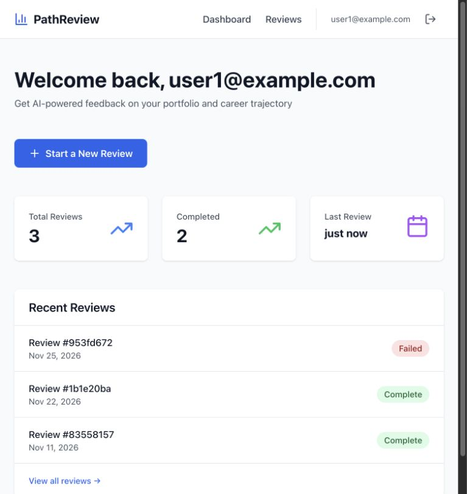

# PathReview Module 3 Journal

- **Student:** Shreejay Subedi
- **GitHub:** [shreejaysubedi](https://github.com/shreejaysubedi)
- **Fork:** [pathreview-ai201-fa26-howard](https://github.com/shreejaysubedi/pathreview-ai201-fa26-howard)

## Unit 7 — Issue selection and setup

**Work date:** November 25, 2026 (America/New_York)

### Selected issue

- **Issue:** [#72](https://github.com/codepath/pathreview-ai201-fa26-howard/issues/72)
- **Title:** `verify_password` raises `UnknownHashError` on malformed stored hashes instead of returning False
- **Tier:** Tier 1 (`tier-1`, `good first issue`, `bug`, `api`)
- **Branch:** `fix/72-malformed-password-hashes`
- **Working-branch URL:** https://github.com/shreejaysubedi/pathreview-ai201-fa26-howard/tree/fix/72-malformed-password-hashes
- **Claim confirmation:** [Comment posted on issue #72](https://github.com/codepath/pathreview-ai201-fa26-howard/issues/72#issuecomment-7175847862)

### Problem summary

PathReview checks a login password against a stored bcrypt hash using `verify_password()` in `core/security.py`. The function currently passes the stored value directly to Passlib, so an unrecognized hash can raise `UnknownHashError` instead of returning a boolean. The login route catches that error as an unexpected failure and returns a server error rather than rejecting the credentials normally. A successful fix will return `False` for malformed stored hashes while preserving the existing behavior for correct and incorrect passwords against valid bcrypt hashes.

### Issue-fit checklist and selection reasoning

- **Clear target:** The issue names the verification function and its existing regression test. Its expected outcome is a concrete boolean result.
- **Affected implementation:** `core/security.py`, specifically `verify_password()`.
- **Caller to verify:** `api/routes/auth.py`, specifically `login()`, which uses the result to reject invalid credentials.
- **Nearby tests:** `tests/unit/test_security.py` already covers valid passwords, incorrect passwords, case sensitivity, salt behavior, empty passwords, and special characters. `test_verify_with_wrong_hash_format` is marked `xfail(strict=True)` for issue #72 / manifest H-05.
- **Before and after:** A malformed stored hash currently escapes as an exception. After the fix, verification should return `False`, allowing the login route's existing invalid-credentials response.
- **Scope:** One authentication helper and focused tests provide a manageable contribution for catching up. The issue's stated estimate is 1–2 hours for the fix, with setup and course documentation taking additional time.
- **Dependencies:** Passlib and bcrypt are already project dependencies. The relevant unit tests can run without calling an LLM or using a real GitHub token.
- **Risk to investigate in Unit 8:** Identify the specific malformed-hash exceptions that should become `False` without hiding unrelated programming errors. Preserve verification of valid bcrypt hashes.
- **Completion evidence to produce later:** Add or strengthen regression cases, remove only the issue #72 `xfail` marker when the fix passes, and run the required checks.

### Code and data-flow notes

1. `frontend/src/pages/LoginPage.tsx` collects the login credentials.
2. `frontend/src/services/api.ts` sends them to `POST /auth/login` through Vite's `/api` proxy.
3. `api/routes/auth.py::login()` looks up the user and passes the submitted password and stored hash to `core/security.py::verify_password()`.
4. Passlib's bcrypt context performs the comparison. A `False` result leads to HTTP 401; an unexpected exception reaches the login route's HTTP 500 handler.
5. `tests/unit/test_security.py` exercises the helper's public behavior, including the seeded malformed-hash case.

### Setup confirmation

- [x] Forked and cloned the Howard repository.
- [x] Read `README.md`, `docs/SETUP.md`, `docs/CONTRIBUTING.md`, and `docs/ARCHITECTURE.md`.
- [x] Read the issue body, relevant helper, login caller, and nearby tests.
- [x] Added `upstream` pointing to `https://github.com/codepath/pathreview-ai201-fa26-howard.git`.
- [x] Created the working branch named above.
- [x] Created an ignored `.env` from `.env.example`, using `LLM_PROVIDER=mock`.
- [x] Created `.venv`, installed the backend and development dependencies, and installed the repository's pre-commit hook.
- [x] Installed frontend dependencies using `npm ci`.
- [x] Started PostgreSQL, Redis, and ChromaDB; all three passed their container health checks.
- [x] Ran database migrations to revision `002 (head)` and seeded the supplied demo accounts and reviews.
- [x] Started the application with `make run` and opened `http://localhost:5173`.
- [x] Logged in with the supplied `user1@example.com` demo account and verified the dashboard displayed its three seeded reviews.



Local tool versions: Python 3.13.7, Node.js 22.20.0, npm 10.9.3, Docker 29.0.1, and Docker Compose 2.40.3. The repository's CI uses Python 3.11; CI results will be checked with the later PR.

### Setup issues and resolutions

- **Docker Desktop was stopped:** Started it before bringing up the backing services.
- **Occupied ports:** An existing local app uses ports 5433 and 8001. PathReview uses PostgreSQL on 15433 and ChromaDB on 18001 through an ignored local Compose override at `.venv/compose.local.yml`. The ignored `.env` points to those ports.
- **ChromaDB image compatibility:** The pinned `chromadb/chroma:0.4.22` image failed because its startup dependency installation selected NumPy 2, which removed `np.float_`. The local override mounts `.venv/chroma-constraints.txt` containing `numpy<2` and sets `PIP_CONSTRAINT` to that file inside the container.
- **ChromaDB health check:** The image lacks `curl`, so the local override checks the same heartbeat endpoint using Python's `urllib.request`.
- **Tokenizer download:** The first unit-test run could not download `cl100k_base` inside the restricted network environment. Downloaded its tokenizer data with network access, then reran the suite successfully.

To start backing services again on this machine:

```bash
docker compose -f docker-compose.yml -f .venv/compose.local.yml up -d --wait
make run
```

The port and dependency workarounds are local setup files inside ignored `.env` / `.venv` paths. This journal records them so the local setup can be understood and repeated.

### Baseline checks actually run

- `make test-unit`: **375 passed, 53 xfailed**. The expected failures include seeded course defects.
- `make lint`: **passed**.
- `.venv/bin/python -m pip check`: **passed**.
- `cd frontend && npm test -- --run`: **18 passed** across two test files.
- `cd frontend && npm run build`: **passed**.
- `GET http://localhost:8000/`: returned the running API message.
- ChromaDB's heartbeat endpoint responded, and all three containers passed health checks.

### Cohort ledger and submission status

**Cohort-ledger confirmation: pending.** The Howard ledger row has not been entered or verified. Google Drive access is not connected in this session.

Ledger: https://docs.google.com/spreadsheets/d/1-39i16vRXrVwGKUHwxWfg2w_UAgsmxUYaR1oJ2djH8w

Row values to enter in the **Howard** tab: **Shreejay Subedi**, **shreejaysubedi**, **issue #72**. Leave the PR link blank until a PR exists.

**Unit 7 course submission: pending.** Submit the working-branch URL above in Unit 7's project submission form after confirming the journal is visible on that branch.

### AI assistance

Codex inspected the repository and live issue, helped configure and verify the local environment, and helped draft this journal from the observed results. 

## Unit 8 — Reproduction and solution plan

- **Work date:** November 25, 2026 (America/New_York)
- **Issue:** [#72](https://github.com/codepath/pathreview-ai201-fa26-howard/issues/72)
- **Branch:** `fix/72-malformed-password-hashes`

### Reproduction summary

Running the existing malformed-hash test with `--runxfail` reproduced `UnknownHashError` escaping from `core/security.py::verify_password()` instead of returning `False`. A separate check of a truncated bcrypt-formatted string raised `ValueError`, identifying a second malformed-hash path to include in the solution plan.

### Reproduction evidence

[Recorded commands, observed output, exit codes, and boundary cases](docs/evidence/unit8-reproduction.txt)

Run from the repository root:

```bash
.venv/bin/pytest tests/unit/test_security.py::TestSecurity::test_verify_with_wrong_hash_format -q --runxfail --tb=short --disable-warnings
```

**Observed:** exit code **1**, with `passlib.exc.UnknownHashError: hash could not be identified` at `core/security.py:37`. The input is the synthetic string `not_a_valid_bcrypt_hash`; the required result is `False`.

The test is intentionally marked `xfail(strict=True)` for issue #72 / manifest H-05. `--runxfail` exposes the failure without editing the test marker. Running the entire security test file normally produced **24 passed, 1 xfailed**, with exit code **0**.

The relevant helper, its `login()` caller in `api/routes/auth.py`, the user model and schemas, and nearby security tests were inspected. The helper lets Passlib's exception escape; the login route then reaches its generic HTTP 500 handler. The intended behavior is for malformed stored hashes to return `False` so the route uses its existing HTTP 401 invalid-credentials response.

**Reproduction commit:** [18fcce3 — reproduce issue #72](https://github.com/shreejaysubedi/pathreview-ai201-fa26-howard/commit/18fcce31ea1b7e84ea5951d603830b2a7af1a491). This commit records the evidence before introduction of the solution plan.

### Solution plan

[PLAN.md](PLAN.md) contains all six required sections: Understand, Map, Plan, Inputs & outputs, Risks & unknowns, and Edge cases. It identifies the helper and caller, gives five ordered tasks, defines the intended verification and HTTP results, and covers concrete malformed-hash, valid-password, and error-propagation cases.

The plan is introduced in a separate commit after the reproduction evidence. Its proposed exception boundary follows the observed difference between an unrecognized hash (`UnknownHashError`) and a recognized but truncated bcrypt value (`ValueError`). Implementation and the issue-specific marker removal are planned for Unit 9.

### Blockers and open questions

**No current blockers for Unit 8.** Reproduction runs with the installed local dependencies and requires no database changes, LLM calls, or external accounts.

Unit 9 will verify the planned exception boundary, add the isolated login-route coverage, and confirm the required local checks and CI results. The existing long-password and whitespace tests are controls for preserving behavior. The plan records the local/CI dependency differences and how to keep unrelated backend failures visible.

### Submission status

**Unit 8 course submission: pending.** Submit the same working-branch URL used for Unit 7:

https://github.com/shreejaysubedi/pathreview-ai201-fa26-howard/tree/fix/72-malformed-password-hashes

### AI assistance

Codex ran the reproduction and security baseline, investigated the additional malformed-hash cases, checked Passlib's documentation against the installed exception hierarchy, and drafted the evidence and six-section plan. All reported test outcomes above were observed during this Unit 8 work.
